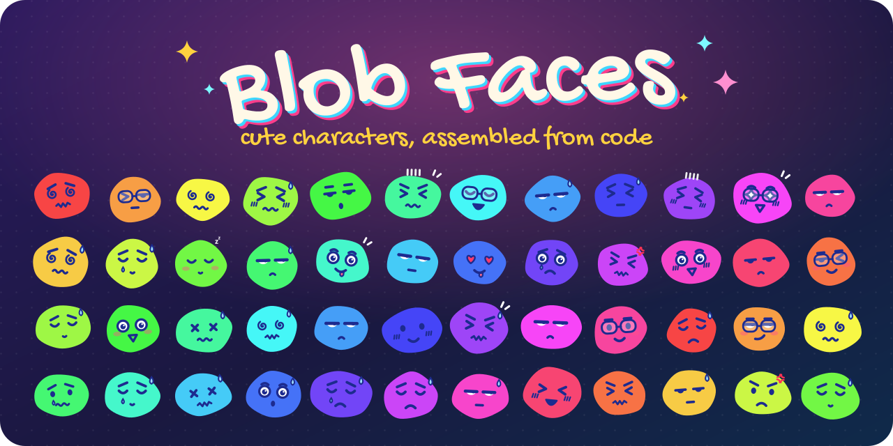

<p align="center"></p>

<h1 align="center">Blob Faces</h1>

<p align="center">Assemble cute, animated blob characters from code.<br>
A tiny, zero-dependency SVG generator — plus a playground to poke them.</p>

<p align="center"><a href="./README.zh-CN.md">简体中文</a></p>

---

```ts
import { renderFace } from 'blob-faces';

renderFace({ mood: 'smug', color: '#ff8090', eyes: 'sideEye', mouth: 'smirk' });
// → '<svg xmlns="http://www.w3.org/2000/svg" viewBox="0 0 120 120">…</svg>'
```

## Features

- **Characters are data.** A face is a small JSON spec: mood, color, shape seed, eyes, brows, mouth, extras.
- **Pure strings, no DOM.** Works in browsers, Node, SSR, edge runtimes, build scripts.
- **10 moods, 40+ parts** out of the box, each mood with its own body animation.
- **Extensible.** Register your own eyes, mouths or moods with one call — no forking.
- **Optional extras:** animation CSS, a React component, and an 8-bit sound engine.
- **Fully typed.** Written in TypeScript; built-in part names autocomplete.

## Install

```bash
npm install blob-faces
```

## Usage

### Static SVG

```ts
import { renderFace, createSpec } from 'blob-faces';

const svg = renderFace(createSpec({ mood: 'happy' }), { size: 96, title: 'Happy blob' });
document.body.insertAdjacentHTML('beforeend', svg);
```

### Animated

```ts
import 'blob-faces/faces.css';
import { renderFace } from 'blob-faces';

el.innerHTML = renderFace(spec, { animated: true });
```

The animated output has nested layers you can drive from your own code:

| Hook | What it does |
|---|---|
| `.bf-blink` on `<svg>` | Closes the blinking eyes |
| `.bf-lookL` on `<svg>` | Side-eyes look left |
| `.bf-look` group | Translate it to make the face look somewhere |
| `.bf-pop.bf-go` | Plays the squash-and-stretch "pop" |
| `--bf-delay` | Offsets the body animation so a crowd doesn't move in sync |

### React

```tsx
import 'blob-faces/faces.css';
import { BlobFace } from 'blob-faces/react';

<BlobFace spec={{ mood: 'excited', color: '#1fd89a' }} size={80} animated />
```

### Reproducible randomness

```ts
import { createSpec, mulberry32 } from 'blob-faces';

createSpec({ rng: mulberry32(42) }); // same seed → same character, every time
```

## The spec

```ts
interface FaceSpec {
  mood: 'happy' | 'angry' | 'sad' | 'shocked' | 'smug' | 'dizzy' | 'excited' | 'sleepy' | 'meh' | 'cringe';
  color: string;          // any CSS color
  shape: number;          // integer seed for the blob outline
  eyes: [left, right];    // 'dot' | 'big' | 'wide' | 'happy' | 'closed' | 'squint' | 'lid' | 'sideEye' | 'spiral' | 'x' | 'star' | 'heart'
  brows: string;          // 'none' | 'angry' | 'worried' | 'raised' | 'flat'
  mouth: string;          // 'smile' | 'grin' | 'o' | 'tri' | 'wavy' | 'flat' | 'frown' | 'cat' | 'tongue' | 'zigzag' | 'smirk' | 'tiny' | 'pout'
  extras: string[];       // 'blush' | 'blushLines' | 'tears' | 'glasses' | 'sweat' | 'action' | 'hair' | 'vein' | 'zzz'
}
```

Every field is optional when rendering — `normalizeSpec` fills in defaults and replaces unknown parts.

## Adding your own parts

```ts
import { definePart, defineMood } from 'blob-faces';

definePart('eyes', 'sleepyDot', {
  blink: true,
  draw: ({ ink }) => `<ellipse rx="4" ry="2.5" fill="${ink}"/>`,
});

defineMood('chill', {
  anim: 'sway',
  eyes: ['sleepyDot', 'lid'],
  brows: ['none'],
  mouth: ['smile', 'tiny'],
  extras: ['blush'],
});
```

Each part draws around its own origin (`side` is `-1` for the left eye/brow and `1` for the right). Extras draw around the face center and choose a `layer`: `under` / `over` the features, or `out` (doesn't follow the gaze). See [CONTRIBUTING.md](./CONTRIBUTING.md) for the coordinate guide.

## API

| Export | Description |
|---|---|
| `renderFace(spec, opts?)` | Full `<svg>` string. Options: `size`, `ink`, `animated`, `title`, `className` |
| `renderParts(spec, opts?)` | Just the face, centered at `(0, 0)` — embed it in your own SVG |
| `createSpec({ mood?, base?, rng? })` | Random spec following a mood's preferences |
| `normalizeSpec(input)` | Fill defaults, drop unknown parts |
| `definePart(kind, key, def)` / `defineMood(key, def)` | Extend the registries |
| `PARTS`, `MOODS`, `PALETTE` | Built-in registries and palette |
| `blobPath(seed)` | The blob outline as an SVG path |
| `blob-faces/react` → `BlobFace` | React component |
| `blob-faces/audio` → `createChiptune()` | 8-bit sound effects + background loop (Web Audio, no files) |

## Playground

```bash
npm install
npm run dev
```

Hover to poke, click to inspect and edit any character's DNA, shuffle with <kbd>R</kbd>, mute with <kbd>M</kbd>. The playground UI is available in English, 简体中文 and 日本語.

```
src/
├── core/        the library — pure string rendering, no DOM
│   ├── parts/   built-in eyes, brows, mouths, extras (each registers itself)
│   └── faces.css
├── audio/       optional 8-bit sound engine
├── react/       optional React component
└── playground/  the demo app — modules talk only through a typed event bus
```

## Scripts

| | |
|---|---|
| `npm run dev` | Playground with hot reload |
| `npm test` | Unit tests (Vitest) |
| `npm run typecheck` | TypeScript check |
| `npm run build` | Library → `dist/`, playground → `site/` |

## License

[MIT](./LICENSE)
