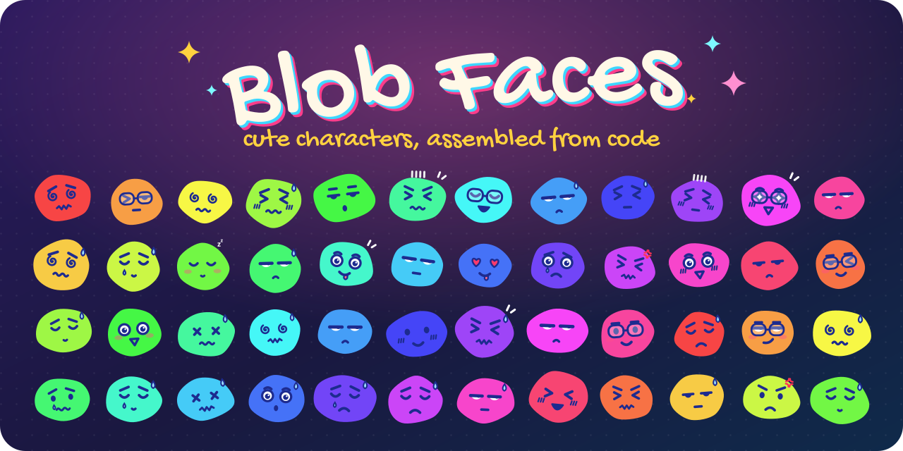

<p align="center"></p>

<h1 align="center">Blob Faces</h1>

<p align="center">用代码组装可爱的、会动的软糖角色。<br>
一个零依赖的小型 SVG 生成库，外加一个可以"戳一戳"的 Playground。</p>

<p align="center"><a href="./README.md">English</a></p>

---

```ts
import { renderFace } from 'blob-faces';

renderFace({ mood: 'smug', color: '#ff8090', eyes: 'sideEye', mouth: 'smirk' });
// → '<svg xmlns="http://www.w3.org/2000/svg" viewBox="0 0 120 120">…</svg>'
```

## 特点

- **角色就是数据**：一张脸是一小段 JSON，包含情绪、颜色、脸型 seed、眼睛、眉毛、嘴巴和装饰。
- **纯字符串输出，不依赖 DOM**：浏览器、Node、服务端渲染、构建脚本都能用。
- **内置 10 种情绪、40 多个部件**：每种情绪有自己的身体动效。
- **可扩展**：一行代码就能注册新的眼睛、嘴巴或情绪，不用 fork。
- **可选模块**：动画 CSS、React 组件、8-bit 音效引擎，用哪个引哪个。
- **完整类型**：用 TypeScript 编写，内置部件名都有自动补全。

## 安装

```bash
npm install blob-faces
```

## 用法

### 静态 SVG

```ts
import { renderFace, createSpec } from 'blob-faces';

const svg = renderFace(createSpec({ mood: 'happy' }), { size: 96, title: '开心' });
document.body.insertAdjacentHTML('beforeend', svg);
```

### 带动画

```ts
import 'blob-faces/faces.css';
import { renderFace } from 'blob-faces';

el.innerHTML = renderFace(spec, { animated: true });
```

带动画的输出有几层可以从外部控制：

| 钩子 | 作用 |
|---|---|
| `<svg>` 上加 `.bf-blink` | 眨眼 |
| `<svg>` 上加 `.bf-lookL` | 斜眼看向左边 |
| `.bf-look` 这一层 | 平移它，让脸看向某个方向 |
| `.bf-pop.bf-go` | 播放一次"啵"的挤压回弹 |
| `--bf-delay` | 错开身体动效的节奏，一群角色不会同步晃 |

### React

```tsx
import 'blob-faces/faces.css';
import { BlobFace } from 'blob-faces/react';

<BlobFace spec={{ mood: 'excited', color: '#1fd89a' }} size={80} animated />
```

### 可复现的随机

```ts
import { createSpec, mulberry32 } from 'blob-faces';

createSpec({ rng: mulberry32(42) }); // 同一个 seed，永远是同一个角色
```

## Spec 格式

```ts
interface FaceSpec {
  mood: 'happy' | 'angry' | 'sad' | 'shocked' | 'smug' | 'dizzy' | 'excited' | 'sleepy' | 'meh' | 'cringe';
  color: string;          // 任意 CSS 颜色
  shape: number;          // 脸型 seed（整数）
  eyes: [左眼, 右眼];      // 'dot' | 'big' | 'wide' | 'happy' | 'closed' | 'squint' | 'lid' | 'sideEye' | 'spiral' | 'x' | 'star' | 'heart'
  brows: string;          // 'none' | 'angry' | 'worried' | 'raised' | 'flat'
  mouth: string;          // 'smile' | 'grin' | 'o' | 'tri' | 'wavy' | 'flat' | 'frown' | 'cat' | 'tongue' | 'zigzag' | 'smirk' | 'tiny' | 'pout'
  extras: string[];       // 'blush' | 'blushLines' | 'tears' | 'glasses' | 'sweat' | 'action' | 'hair' | 'vein' | 'zzz'
}
```

渲染时每个字段都可以省略，`normalizeSpec` 会补上默认值，未知部件会换成默认部件。

## 添加自己的部件

```ts
import { definePart, defineMood } from 'blob-faces';

definePart('eyes', 'sleepyDot', {
  blink: true,
  draw: ({ ink }) => `<ellipse rx="4" ry="2.5" fill="${ink}"/>`,
});

defineMood('chill', {
  anim: 'sway',
  eyes: ['sleepyDot', 'lid'],
  brows: ['none'],
  mouth: ['smile', 'tiny'],
  extras: ['blush'],
});
```

每个部件以自己的中心为原点绘制；`side` 为 `-1` 表示左眼/左眉，`1` 表示右边。装饰以整张脸的中心为原点，并通过 `layer` 指定层级：`under` 在五官下面，`over` 在五官上面，`out` 不跟随视线。坐标规则见 [CONTRIBUTING.md](./CONTRIBUTING.md)。

## API

| 导出 | 说明 |
|---|---|
| `renderFace(spec, opts?)` | 完整的 `<svg>` 字符串。选项：`size`、`ink`、`animated`、`title`、`className` |
| `renderParts(spec, opts?)` | 只输出脸本身，以 `(0, 0)` 为中心，可嵌进你自己的 SVG |
| `createSpec({ mood?, base?, rng? })` | 按情绪偏好随机生成 spec |
| `normalizeSpec(input)` | 补默认值、去掉未知部件 |
| `definePart(kind, key, def)` / `defineMood(key, def)` | 扩展注册表 |
| `PARTS`、`MOODS`、`PALETTE` | 内置注册表和调色板 |
| `blobPath(seed)` | 脸型轮廓的 SVG path |
| `blob-faces/react` → `BlobFace` | React 组件 |
| `blob-faces/audio` → `createChiptune()` | 8-bit 音效和背景乐（Web Audio 实时合成，无音频文件） |

## Playground

```bash
npm install
npm run dev
```

悬停戳一下，点击查看并编辑角色的 DNA；<kbd>R</kbd> 换一批，<kbd>M</kbd> 静音。界面支持简体中文、English、日本語。

```
src/
├── core/        核心库：纯字符串渲染，不依赖 DOM
│   ├── parts/   内置眼睛、眉毛、嘴巴、装饰（各自注册到注册表）
│   └── faces.css
├── audio/       可选：8-bit 声音引擎
├── react/       可选：React 组件
└── playground/  演示应用：模块之间只通过带类型的事件总线通信
```

## 脚本

| | |
|---|---|
| `npm run dev` | 启动 Playground（热更新） |
| `npm test` | 单元测试（Vitest） |
| `npm run typecheck` | TypeScript 类型检查 |
| `npm run build` | 库 → `dist/`，Playground → `site/` |

## 许可

[MIT](./LICENSE)
